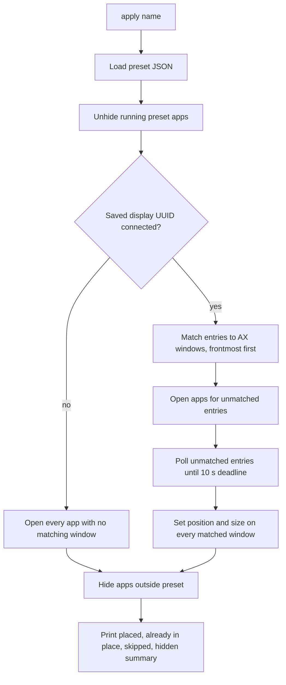

# Workspace Presets - Plan

## Goal Capsule

- **Objective:** Robert switches into a work or personal mode with one Raycast command, and every app for that mode is open and sitting in its saved spot on the 40" monitor within seconds, with nothing dragged by hand.
- **Means:** A small native Swift command-line tool that saves and applies named presets, invoked by one Raycast Script Command per preset.
- **Product authority:** Robert is the sole user and decides product behavior. This is a personal tool; there is no distribution, onboarding, or second user.
- **Open blockers:** None.
- **Stop conditions:** Stop and report if Chrome window titles stop carrying the profile name (R3), or if Accessibility cannot be granted to the process running the tool.
- **Execution profile:** Built and proven on the built-in display on 2026-10-28; the 40" acceptance run (AE1, AE5, timing goal) is a recorded manual check because the monitor is not connected.
- **Product Contract preservation:** Product Contract unchanged; the R3 assumption is marked verified and the deferred planning questions point to the KTDs that resolve them.

---

## Product Contract

### Summary

A Swift command-line tool with two commands. `save <name>` records which app sits in which spot on the current monitor. `apply <name>` launches missing apps, moves each saved window into place, and hides every app outside the preset. Raycast triggers each preset; the tool never restores what is inside a window.

### Problem Frame

Robert works on a single 40" monitor with six windows in a fixed 3x2 arrangement. Every time he starts work he opens the apps and drags each window into its slot with Rectangle. The arrangement never changes, so the repetition is pure friction. He previously used a Setapp app (likely Workspaces by Apptorium) that did this and wants his own version, partly for a custom fit and partly for the fun of building it.

His current work preset, for reference:

| Slot | App |
|---|---|
| Top left | Notion |
| Top middle | Chrome, work profile |
| Top right | Chrome, personal profile |
| Bottom left | Cursor |
| Bottom middle | WezTerm |
| Bottom right | Amp |

### Key Decisions

- **Presets are captured, not authored.** Robert arranges windows by hand once, as he already does, and saves the result; there is no layout editor or config to write. (session-settled: user-approved — chosen over a grid editor or a config file: captures his real arrangement with zero editing UI.) Governs R1, R2.
- **Launch and place only.** Apps restore their own content (tabs, projects, sessions). (session-settled: user-approved — chosen over opening specific URLs or folders and full content restore: each content type would be a separate integration.) Governs R5.
- **Other apps are hidden, not quit or left in place.** (session-settled: user-approved — chosen over leaving them or quitting them: clears the screen without risking unsaved work.) Governs R7.
- **Raycast is the only trigger surface.** No menu bar item, no built-in hotkeys; Raycast supplies search and hotkeys. (session-settled: user-directed — chosen over a menu bar list with hotkeys: Robert already lives in Raycast.) Governs R10.
- **The tool positions windows itself.** Robert uses Rectangle-style snapping, which only acts on command, so there is no tiling manager to drive or fight. (session-settled: user-directed — chosen over integrating with a tiling window manager: he does not use one.) Governs R4.
- **Build approach A: Swift CLI plus Raycast Script Commands.** (session-settled: user-directed — chosen over a Hammerspoon config and a full Raycast extension: least code to own while still a real native build; a Raycast extension can sit on top later.)

### Requirements

**Saving a preset**

- R1. `save <name>` records, for each visible window on the current display, the app, its position and size, and the display it was saved on.
- R2. Saving under an existing name overwrites that preset without confirmation.
- R3. Windows of the same app are distinguished by Chrome profile, so the work and personal Chrome windows save as separate entries.

**Applying a preset**

- R4. `apply <name>` moves each saved window to its saved position and size.
- R5. Apps in the preset that are not running are launched, Chrome entries into their saved profile, and the tool does not open any specific file, URL, or project.
- R6. When an app has several matching windows, the most recently used one is placed and the rest are left where they are.
- R7. Every running app not in the preset is hidden.
- R8. When the display the preset was saved on is not connected, apps are launched but no window is moved.
- R9. When a launched app's window does not appear within a short, bounded wait, that entry is skipped and the rest of the preset still applies.

**Triggering**

- R10. Each preset is triggered by its own Raycast Script Command, and saving a new preset is also runnable from Raycast.

### Acceptance Examples

- AE1. **Covers R4, R5, R7.** Given only Spotify and Messages are open, when Robert runs Apply Work, then all six work apps open in their slots and Spotify and Messages are hidden.
- AE2. **Covers R6.** Given three work-profile Chrome windows are open, when Robert runs Apply Work, then the most recently used one moves to top middle and the other two stay where they were.
- AE3. **Covers R8.** Given the laptop is undocked from the 40" monitor, when Robert runs Apply Work, then missing apps launch and no window moves.
- AE4. **Covers R9.** Given Cursor takes too long to show a window, when Robert runs Apply Work, then the other five windows are placed and Cursor is left unplaced.
- AE5. **Covers R3, R5.** Given Chrome is not running, when Robert runs Apply Work, then one window opens in the work profile at top middle and one in the personal profile at top right.

### Success Criteria

- From a cold start with none of the six apps running, Apply Work leaves all six windows in place in well under 15 seconds.
- Running Apply Work twice in a row changes nothing the second time.

### Scope Boundaries

**Deferred for later**

- A Raycast extension UI for listing, renaming, and deleting presets.
- Presets spanning multiple monitors or macOS Spaces.
- Opening specific files, URLs, or project folders per window.
- Proportional scaling of a layout onto a different display.
- A visual layout editor.
- A `presets list` command; the presets directory can be listed directly.

**Outside this tool's identity**

- Content restore (tabs, terminal sessions, editor state).
- A general window manager or snapping tool; Rectangle keeps that job.
- Distribution to other users.

### Dependencies / Assumptions

- macOS Accessibility permission is granted to whatever process runs the tool (likely Raycast, which typically already holds it for its own window commands).
- Chrome shows the profile name in each window title when more than one profile exists. Verified on Robert's machine on 2026-10-27: Accessibility titles read `<page> - Google Chrome - Robert (Work)` and `<page> - Google Chrome - Robert (Robert Guss)`, where the parenthesized text is the profile `name` in Chrome's `Local State`.
- Amp runs as its own desktop app with its own window, not as a WezTerm or Chrome tab.

### Outstanding Questions

The three questions deferred to planning are resolved by KTD3 (Chrome profile), KTD5 (storage), and KTD6 (bounded wait).

---

## Planning Contract

### Key Technical Decisions

- KTD1. **SwiftPM package with a pure core library and a thin executable.** `PresetsCore` holds the preset model, storage, Chrome title parsing, profile lookup, window matching, and frame math, all testable without Accessibility. The `presets` executable owns every macOS call (AX, NSWorkspace, NSScreen). The macOS calls cannot run in CI-style unit tests, so keeping them in one thin layer keeps the tested surface large.
- KTD2. **Windows are read and moved through the public Accessibility API.** `AXUIElementCreateApplication` plus `kAXWindowsAttribute`, filtered to `AXStandardWindow`, not minimized, and with a frame intersecting the target display. Position and size are set with `kAXPositionAttribute` and `kAXSizeAttribute`, with position set again after size so a window that was clamped by the old position lands exactly. When an app reports `AXEnhancedUserInterface` as on (Chrome and Electron apps can), it is turned off for the move and restored afterward, because it makes the moves animate and land wrongly. No private API is used.
- KTD3. **Chrome profile identity comes from the window title and Chrome's `Local State`.** A Chrome window title ends in ` - Google Chrome - <label>`. The profile is the `info_cache` entry whose `name` equals the label or the text inside the label's trailing parentheses. The entry stores the profile directory (for example `Profile 5`) plus the display label. Launching into a profile uses `NSWorkspace.openApplication` with `--profile-directory=<dir>` and a new application instance, which Chrome hands to the running process and opens a window in that profile. When Chrome is cold, the second profile launches only after the first Chrome window appears, so two launches do not race Chrome's single-process handoff. Governs R3, R5.
- KTD4. **Most recently used means first in the app's AX window order.** AX returns an app's windows front to back. When a preset holds N entries with the same identity (app plus profile), the N frontmost matching windows are assigned in order and the rest are untouched. Governs R6.
- KTD5. **Presets are JSON files under `~/Library/Application Support/WorkspacePresets/`, one file per name.** Writing replaces the file atomically, so saving under an existing name overwrites it (R2). The `PRESETS_DIR` environment variable overrides the directory, which lets tests and proof runs avoid touching real presets.
- KTD6. **Cold-launched windows get one shared 10-second deadline.** Every missing app is launched first, then one loop polls all pending entries every 150 ms until each has a window or the deadline passes. Entries still without a window are reported and skipped (R9). The shared deadline keeps a cold start of six apps under the 15-second success criterion.
- KTD7. **Displays are identified by CoreGraphics display UUID, and frames are stored relative to the display origin.** Display origin and size come from `CGDisplayBounds`, which shares the top-left global space AX uses; `NSScreen` is used only for the display name. A preset stores the UUID, the localized display name, and the display's size. On apply, a missing UUID means no window moves (R8). Relative frames survive a change in display arrangement.
- KTD8. **Hiding uses `NSRunningApplication.hide()` on every regular app outside the preset, and every preset app is unhidden first.** Unhiding matters because switching presets hides the previous preset's apps, and a hidden app's windows would otherwise be moved but stay invisible. The process running the tool and apps with no regular activation policy (Raycast, menu bar agents) are skipped. Governs R7.
- KTD9. **Apps without a matching window are opened through `NSWorkspace.openApplication`.** That call launches an app that is not running and sends a reopen event to one that is, and most apps answer the reopen event by creating a window. Robert's apps restore their own content (R5). Running apps with no window, for example Notion after its last window closes, are covered the same way.

### High-Level Technical Design



The save path is the reverse: take the display holding the frontmost app's focused window (the main display when there is none), list every visible standard window on it through AX, derive an identity for each (bundle ID plus Chrome profile when the app is Chrome), and write the JSON.

### Assumptions

- Minimized windows are not saved. Apply includes minimized windows in matching and restores a matching window before placement instead of opening a duplicate. Windows on other Spaces remain outside the supported scope.
- Raycast already holds Accessibility permission, or Robert grants it once. Proof in this session runs the binary from WezTerm, which holds the permission.
- When an app has several saved entries and fewer open windows, the extra entries get one reopen each; apps that answer reopen without creating a second window leave those entries unplaced and reported.

### Output Structure

```text
Package.swift
Sources/PresetsCore/        model, store, Chrome profile, matching, frame math
Sources/presets/            CLI entry, AX window adapter, launch and hide
Tests/PresetsCoreTests/     unit tests for the core
raycast/                    Raycast Script Commands
scripts/install.sh          release build and copy to ~/.local/bin
README.md
```

---

## Implementation Units

### U1. Package scaffold and preset model

- **Goal:** A buildable SwiftPM package with the `PresetsCore` model, JSON store, and an empty `presets` CLI that prints usage.
- **Requirements:** R1, R2
- **Dependencies:** none
- **Files:** `Package.swift`, `Sources/PresetsCore/Preset.swift`, `Sources/PresetsCore/PresetStore.swift`, `Sources/presets/main.swift`, `Tests/PresetsCoreTests/PresetStoreTests.swift`, `.gitignore`
- **Approach:** `Preset` holds the display (UUID, name, size) and an ordered list of entries (bundle ID, app name, app path, optional Chrome profile directory and label, frame relative to display). Store per KTD5.
- **Test scenarios:**
  - Saving preset `work` then loading it returns equal entries and display.
  - Saving `work` twice with different entries leaves only the second set (R2).
- **Verification:** `swift build` and `swift test` pass.

### U2. Chrome profile resolution

- **Goal:** Turn a Chrome window title into a profile directory and label, and back into launch arguments.
- **Requirements:** R3, R5
- **Dependencies:** U1
- **Files:** `Sources/PresetsCore/ChromeProfiles.swift`, `Tests/PresetsCoreTests/ChromeProfilesTests.swift`
- **Approach:** Per KTD3. Parse `Local State` JSON from a path passed in, so tests use fixture data.
- **Test scenarios:**
  - `Repo - Google Chrome - Robert (Work)` with a Local State listing `Profile 5` named `Work` resolves to `Profile 5`.
  - `Repo - Google Chrome - Robert (Robert Guss)` resolves to `Default`.
  - A page title that itself contains ` - Google Chrome - ` earlier in the string still resolves from the last occurrence.
  - A title with no profile suffix resolves to no profile.
  - A label that matches no profile resolves to no profile directory but keeps the label.
- **Verification:** tests pass; real titles from Robert's Chrome resolve correctly in the U5 proof.

### U3. Window matching and frame math

- **Goal:** Assign saved entries to live windows and convert frames between display-relative and global coordinates.
- **Requirements:** R4, R6, R8
- **Dependencies:** U1
- **Files:** `Sources/PresetsCore/Matching.swift`, `Tests/PresetsCoreTests/MatchingTests.swift`
- **Approach:** Pure function from entries plus live windows (identity, front-to-back order, id) to assignments, per KTD4. Frame math per KTD7.
- **Test scenarios:**
  - Covers AE2. Three work-profile Chrome windows and one entry: the frontmost is assigned and the other two are not.
  - Two WezTerm entries and three WezTerm windows: the two frontmost are assigned in entry order.
  - Work and personal Chrome entries never take each other's windows.
  - An entry with no live window is reported as unmatched.
  - A frame saved at x 600 relative to a display whose origin is now -1800 maps to global x -1200.
  - A frame saved at y 400 relative to a display whose global origin y is -1080 maps to global y -680.
- **Verification:** tests pass.

### U4. Save and apply commands on macOS

- **Goal:** Wire the AX adapter, launching, waiting, moving, and hiding into `presets save <name>` and `presets apply <name>`.
- **Requirements:** R1, R4, R5, R6, R7, R8, R9
- **Dependencies:** U1, U2, U3
- **Files:** `Sources/presets/main.swift`, `Sources/presets/AXWindows.swift`, `Sources/presets/Displays.swift`, `Sources/presets/Apply.swift`, `Sources/presets/Save.swift`
- **Approach:**
  1. Fail early with a message naming System Settings → Privacy & Security → Accessibility when `AXIsProcessTrusted()` is false.
  2. Save per KTD2, KTD3, KTD7.
  3. Apply per the High-Level Technical Design, KTD6, KTD8, KTD9.
  4. Print one line per entry (placed, already in place, or skipped with reason) and a hidden-apps line.
- **Execution note:** This unit is macOS glue; prove it with the U5 real-machine runs rather than unit tests.
- **Test expectation:** none -- the unit is the OS adapter layer, covered by the U5 proof runs.
- **Verification:** U5 proof runs.

### U5. Raycast commands, install, and real-machine proof

- **Goal:** Raycast Script Commands for Apply Work and Save Preset, an install script, a README, and recorded proof runs.
- **Requirements:** R10, success criteria
- **Dependencies:** U4
- **Files:** `raycast/apply-work.sh`, `raycast/save-preset.sh`, `scripts/install.sh`, `README.md`
- **Approach:** Scripts call `~/.local/bin/presets`. Save Preset takes the name as a Raycast text argument. Adding a preset means copying `apply-work.sh` and changing the name.
- **Test expectation:** none -- scripts are thin wrappers; proven by running them directly.
- **Verification:** On the built-in display: save a preset from a hand arrangement, scramble windows, apply, and confirm every frame matches; apply again and confirm nothing changes; quit an app and confirm apply launches and places it; confirm an entry whose app never shows a window is skipped after the deadline while the others are placed; apply a second preset and then the first, and confirm the first preset's apps come back visible; confirm an app outside the preset is hidden; apply a preset whose display UUID is not connected and confirm apps open and no window moves.

---

## Verification Contract

| Gate | Command or check | Proves |
|---|---|---|
| Build | `swift build -c release` | Package compiles |
| Unit tests | `swift test` | U1-U3 core behavior |
| Save/apply proof | `presets save` then scramble then `presets apply` on the built-in display, with frames read back through AX | R1, R3, R4, R6, R7 |
| Most recent window | with two work-profile Chrome windows open, apply and confirm only the frontmost moves | R6, AE2 |
| Idempotence | second `presets apply` reports every window already in place and frames are unchanged | Success criterion 2 |
| Cold launch | quit a preset app, then apply | R5 |
| Window timeout | apply a preset holding an extra entry for an app that never shows a standard window | R9: that entry is skipped after the deadline and the rest are placed |
| Preset switch | apply preset B, then preset A | R7, R4: A's apps come back unhidden and placed |
| Missing display | apply a copy of the preset with a fake display UUID | R8 |
| Raycast | run `raycast/apply-work.sh` directly | R10 |
| Manual, 40" monitor | AE1, AE5, and the under-15-second cold start on the 40" monitor | Recorded as a remaining check in the PR |

## Definition of Done

- All Verification Contract gates except the 40" manual row pass with evidence captured in the PR.
- The 40" manual check is listed in the PR as remaining.
- No abandoned-attempt code, scratch scripts, or debug output remains in the diff.
- `LEARNINGS.md` records the Chrome title format and any AX behavior discovered during the proof.
